# Build log

How Subscription Sweep went from a job ad to a working product in one session on 3 Nov 2026. Written as I went, with screenshots and the actual test output. Times are London.

---

## 1. Picking the problem (18:30)

The Nous Product Builder ad names three possible first surfaces: Nora, Open Banking and subscriptions, or "whatever's most broken". I picked subscriptions because it's where product and growth overlap. A week earlier I'd pulled all of Nous's ads from Meta's Ad Library: 1,268 of them, and not one opens with subscriptions. Members arrive for energy, and the subscription side of Premium is invisible.

## 2. Using Nous as a member would (18:50)

First I looked at how a new member joins. Sign-up is a web app, not an app-store download, and step one asks for your home address.

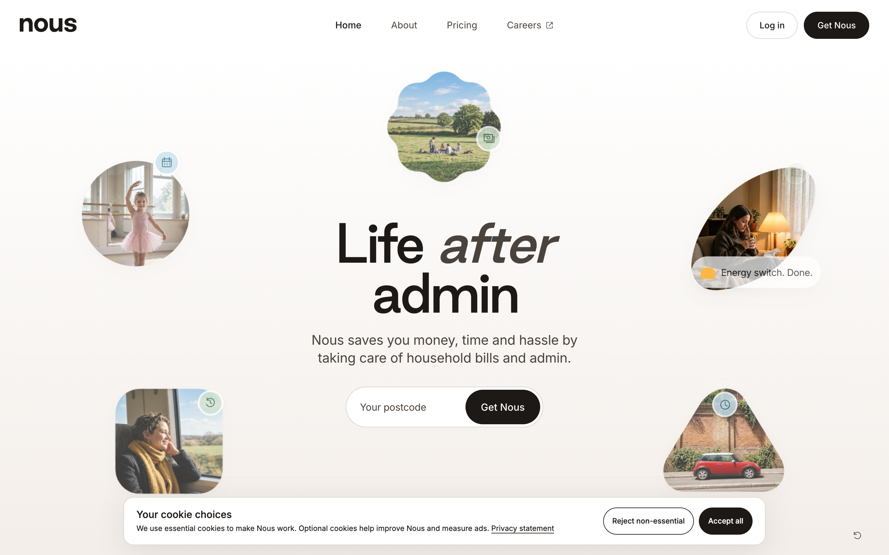
*nous.co, captured 3 Nov 2026*

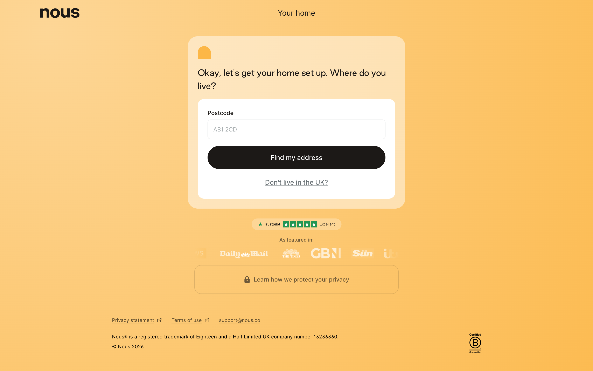
*The first sign-up screen: "Where do you live?" I stopped here. The next step needs my real address, so I'll finish it myself.*

## 3. Listening to members (18:51 → 19:15)

I pulled every public 1–4★ Trustpilot review of Nous plus the newest 200 5★ reviews (477 in total, no login, nothing paid), then read every complaint by hand.

| What I found | What I changed in the product |
|---|---|
| 1 of 477 reviews mentions Nous finding savings on subscriptions; 0 name Netflix, Spotify or a gym | Confirms the gap: this is new, visible value |
| 43% of low reviews are bad money judgement | Rules own every £. AI never writes a number |
| "I'm only interested in my monthly outgoings" | Every flag leads with £ per month |
| 31% of low reviews: acted without a clear yes | The message asks for a yes per item. Nothing on silence |
| All 5 reviews about connecting a bank are negative | The prototype runs on a file you choose to share, read on your device |

Full method and quotes: `research/reviews/findings.md`.

## 4. The engine: rules first (19:00)

Five steps: read the file → name the merchant → find repeats → work out prices and dates → raise flags. Everything is plain TypeScript that runs in the browser, so a statement never leaves the device.

Bugs I caught while writing it, before any test ran:

- A `MICROSOFT*` rule would have swallowed Xbox Game Pass. Moved gaming above software.
- The E.ON energy rule matched **LEON**, the restaurant chain. Fixed with word boundaries, and there's a test for it now.
- A family with two EE phone lines (£32 and £22) would have been merged into one bill. Bills are now split by price too.

## 5. Test data with traps (19:05)

Three made-up households, 12 months each, in three different bank formats (Monzo, Nationwide, Starling) to test the file reader. Each has an answer key written from the spec, not from the engine. Traps on purpose: a weekly food shop, the same £3.40 coffee most days, a £2 bus fare most days, rent to a flatmate by standing order, a refunded double charge, switching gyms (not a duplicate), a cancelled subscription, and one merchant nobody could name.

## 6. First score (19:07)

```
OVERALL (rules-only) subs P 100% R 100% · bills P 100% R 100% · flags P 77.8% R 100% · exact £ 49/49 · AI 0/4
```

Detection was right first time. The flags weren't: 4 false "can't name this one" flags, on Roblox, Patreon, Crunchyroll and a local bakery subscription. Exactly the job the AI layer is for.

## 7. The AI layer (19:08)

One job: turn bank text the dictionary doesn't know into a name, a category and a confidence. It sees only the text, never amounts or dates.

| Bank text | Named as | Sure | Used |
|---|---|---|---|
| ROBLOX CORPORATION | Roblox · gaming | 95% | yes |
| SQ *THE BREAD CLUB | The Bread Club · recipe box | 70% | yes |
| CRUNCHYROLL | Crunchyroll · video | 97% | yes |
| PATREON* MEMBERSHIP | Patreon · creator | 95% | yes |
| KLX*MEMBER SERVICES 0203 | Unknown | 20% | no, stays unnamed |

The last one I invented on purpose. The model said it didn't know, which is the right answer. Score after:

```
OVERALL (rules+ai) subs P 100% R 100% · bills P 100% R 100% · flags P 100% R 100% · exact £ 49/49 · AI 4/4
```

I don't trust that 100%: I wrote the data and the rules. So I had a separate agent write a blind test without seeing the code (section 10).

## 8. Unit tests (19:11)

25 tests for the boring things that break money products: Monzo, Nationwide and Starling files, Windows line endings, commas inside quotes, day-first dates (03/11 is 3 November, never 11 March), LEON vs E.ON, Tesco Mobile vs a Tesco shop, transfers to people, switching gyms, a refund vs a double charge, a trial that converted after one charge, a renewal warning, and never counting one payment twice. All 25 pass. Output saved in `docs/evidence/01-unit-tests.txt`.

## 9. The product (19:20 → 19:45)

Direction before any pixels: a paper bank statement on the kitchen table, marked up with a highlighter. The highlighter only ever touches things that are flagged.

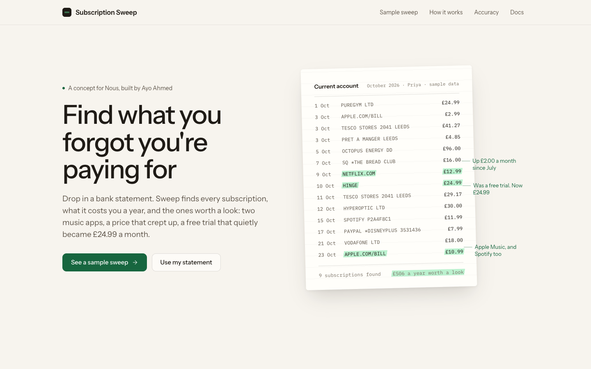
*The hero is Priya's real October statement from the sample data, highlighted by the real engine output. Nothing on it is typed by hand.*

First pass of the results page:

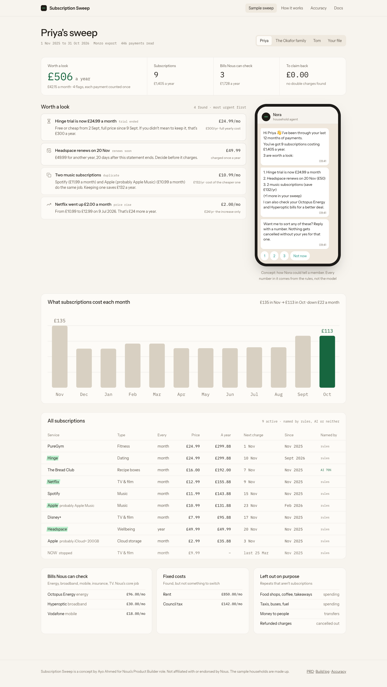
*Version 1. The flags, phone message and table worked. The chart didn't: it said spending went down £22 a month, only because Priya's yearly Headspace charge landed in November.*

The fix: chart what you're signed up to each month, with yearly plans spread over 12 months. Now it shows the actual creep: Apple Music added in February, NOW cancelled in March, Netflix up in July, Hinge in September.

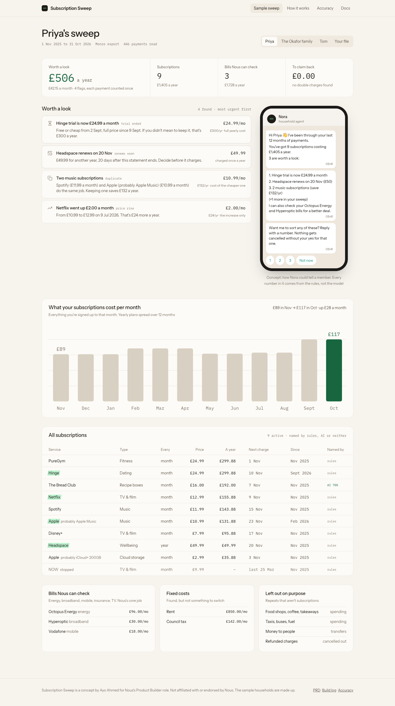
*Version 2: £89 → £117 a month.*

Other things the screenshots caught: two margin notes overlapping in the hero, a vague example line, tables not stretching on the docs pages, and a renewal shown as "£50" when the real charge is £49.99. All fixed. Every screenshot run also checks for console errors and for anything wider than a phone screen: none.

## 10. Trying to break it: seven awkward files (19:25)

A recorded browser session uploads seven files into the real app and checks what a member would see: an empty file, a file that isn't a statement, Barclays and Lloyds exports, a messy file (BOM, Windows line endings, commas inside quotes, £ signs, a bad row), an income-only file, and five years of data for speed.

<video src="videos/edge-cases.mp4" controls width="100%"></video>

*The latest run: 7/7 pass, no page errors.*

It took three runs:

| Run | Result | What it found |
|---|---|---|
| 1 | Crashed after the first file | **No way to upload a second file.** Once you'd uploaded one, the box disappeared. A real member would be stuck. Added "Sweep a different file" |
| 1 | Lloyds failed | **Lloyds calls the column "Transaction Description".** The reader only knew "Description". Fixed, with a unit test |
| 2 | 7/7, but… | The screenshot of the broken file showed "£0 a year worth a look", "1 Jan 1970" and "Nothing looks off. Nice." **An unreadable file looked like an all-clear.** That's the worst kind of bug in a money product |
| 3 | 7/7 with stricter checks | Unreadable files now get a clear error and the upload box, never a £0 result |

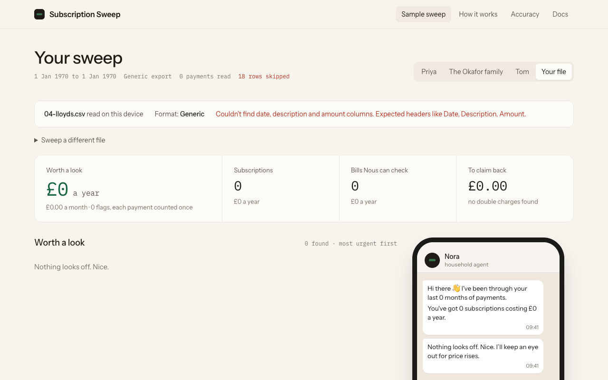
*Run 1. The engine read 0 payments and the page still said nothing looked off.*

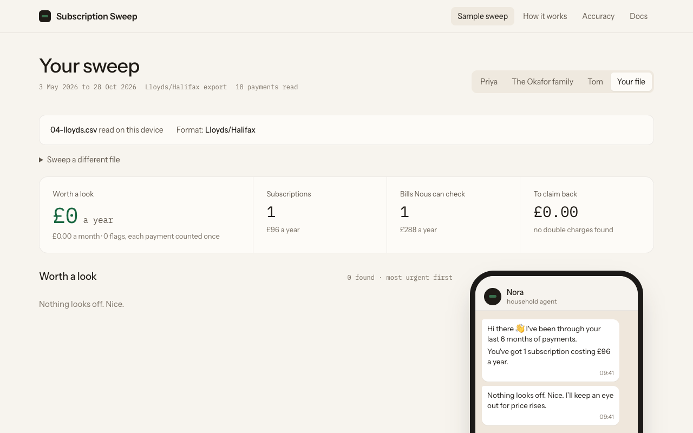
*Run 3. Lloyds read properly: Disney+ found, EE as a bill, salary ignored.*

## 11. The blind test (19:33)

I didn't trust my own 100%, so a separate agent wrote two households without seeing the code, with about 40 traps: Netflix under four names, a file sorted newest first, Tesco six ways, seasonal energy bills, a part-month first gym payment, yearly memberships, a friend paid £6 most Tuesdays.

First run, recorded before I touched anything:

```
OVERALL subs P 87.5% R 80% · bills P 100% R 81% · flags P 52.6% R 47.6% · exact £ 47/47
```

80% of subscriptions found, and fewer than half the flags right. Every price it did find was exact, though. What went wrong:

- **Bugs.** `UBER *ONE`: the asterisk broke the match and it was filed as a taxi. A quarterly magazine's price rise split in two (I only joined price levels up to 40 days apart). Seasonal energy split into several bills. A part-month first gym payment looked like a price rise. A standing order to savings and a friend's 5-a-side money looked like subscriptions. And the rule that strips reference codes also deleted "1Password".
- **A gap in the AI's job.** Yearly plans from merchants nobody's dictionary has (English Heritage, Norton, RAC) were invisible, because one charge isn't a pattern. Now the AI also says whether a merchant is usually paid yearly. That's a fact about the merchant, not the amount, so it stays inside the hand-over rule.
- **My scorer was unfair.** It failed flags when the names differed ("LV=" vs "Liverpool Victoria"). About 5 misses were this. I fixed the scorer, not the engine, and kept the first-run numbers as recorded.
- **One disagreement I'm keeping.** The key says a couple's two phone lines are a duplicate. Two people, two phones. Not flagging it.

After the fixes: 35/35 subscriptions, 21/21 bills, 20/21 flags, 56/56 exact prices, and my own households still at 100%. But that's no longer blind, because I've seen the data. So a second agent is writing a fresh blind set (section 12).

## 12. Walkthrough video (19:45)

A scripted tour of the real app, recorded headless with captions. Voiceover script for recording it in my own voice: `docs/video-script.md`.

<video src="videos/walkthrough.mp4" controls width="100%"></video>

Checking the stills caught three more things: "Two **ai** assistant subscriptions" (lowercased), "You've got **1 subscriptions**", and a Lloyds file labelled "Generic". All fixed, with a test for the plural.

## 13. Battery died, picked back up (20:07 → 20:30)

My laptop died mid-build and the Mac restarted, killing the dev server, the second blind-test agent and a half-finished Notion approval. Everything I'd written was on disk, so the recovery was: check every file, re-run every test and score (identical to before the crash), and check the second blind set was complete without reading its answers: 1,285 payments, 50 labelled repeat payments, 15 expected flags, every answer-key line present.

## 14. The second blind test (20:30)

The question: did the fixes from blind set 1 generalise, or did I just fit that test? A different agent wrote two new households after those fixes, with new traps: Santander and HSBC description styles, subscriptions billed in dollars that wobble by pennies, solo-to-family plan switches, monthly-to-annual switches, a cancelled subscription that charges once more, loans, credit cards, Klarna, cash withdrawals, a weekly cleaner paid by transfer.

First run, before touching anything:

```
OVERALL subs P 72.4% R 84% · bills P 100% R 86.4% · flags P 68.8% R 73.3% · exact £ 42/42
```

| | Set 1, first run | Set 2, first run |
|---|---|---|
| Subscriptions found | 80% | 84% |
| Of what it called subscriptions, right | 87.5% | 72.4% |
| Flags found / right | 48% / 53% | 73% / 69% |
| Exact prices | 47/47 | 42/42 |

So: partly. Flags got much better and prices stayed perfect, but false alarms went up. The causes were real:

- Santander writes `CARD PAYMENT TO PERPLEXITY AI,20.00 USD, RATE 1.3550/GBP ON 18-10-2026`. My BP petrol rule matched the "BP" in "**GBP**", so Perplexity became Transport.
- A Spotify solo → Family switch (+42%) was read as a price rise plus a double charge. Over 25% is now a plan change.
- Adobe switched from monthly to one yearly charge and disappeared.
- RAC's renewal wasn't flagged because renewals only covered subscriptions. Yearly bills now get a renewal warning: that's the moment Nous can switch them.
- Card repayments, a car loan, Klarna, cash withdrawals and a 20p foreign-transaction fee counted as subscriptions. New "loans, cards & fees" category, left out like transfers.
- A £19.30 National Trust café visit became a "yearly plan", because the AI said National Trust is usually annual. That hint now needs £25+.
- An HSBC bill payment to a nursery became a £1,212 "subscription". HSBC "BP" payments count as transfers unless the payee is a known bill.

Re-labelling exposed something I hadn't thought about: **the AI changed its mind.** The same bakery descriptor went from 70% sure to 30% between runs. In production that's a label flip-flopping in front of members. Rule added: a refresh never replaces a confident label with an unsure one.

After the fixes (no longer blind): set 2 25/25 subscriptions, 22/22 bills, 14/15 flags, 47/47 exact; set 1 and my own households unchanged. The one miss I'm leaving: Apple TV+ hidden inside an `APPLE.COM/BILL` charge at a price my hints don't know. That's an honest limit of Apple's bundled billing, not something to paper over. Unit tests: 35. Edge-case test re-run: 7/7.

## 15. Into Notion (20:44)

Docs went to Notion so they're easy to share. Three things broke on the way and are fixed in `scripts/publish-notion.py`: Composio wanted every block wrapped, uploads needed a file path, and headings like "1. Picking the problem" were silently turned into numbered lists. I rebuilt that page and checked it by reading it back: 14 headings, 7 screenshots, 2 videos, no duplicates.

## 16. Live (4 Nov)

It's live at **https://subscription-sweep.vercel.app**, with the code public at **github.com/CashpointSoulja/subscription-sweep**. Before publishing I checked every file for private details and kept my working notes and the raw review data out. That check caught one: the docs page was loading every Markdown file in the folder, so my private notes would have shipped inside the site's code even though nothing linked to them. Fixed, then I scanned the built site for private strings (none) and re-ran the upload tests against the live site: 7/7.

## 17. Making it feel steady (4 Nov)

Using it myself, it felt fidgety: press a household and the whole page moves. Three causes, all in my code:

1. **The household switcher sat beside the title.** "Priya's sweep" is short, "The Okafor family's sweep" is long, so the switcher's position depended on whose sweep it was. In a narrower window it dropped onto its own line.
2. **Every click jumped back to the top.** The router scrolled to the top on any change, including switching household.
3. **The scrollbar came and went.** The sample pages are long and "Your file" is short, so the scrollbar appeared and disappeared and the whole layout slid sideways by its width.

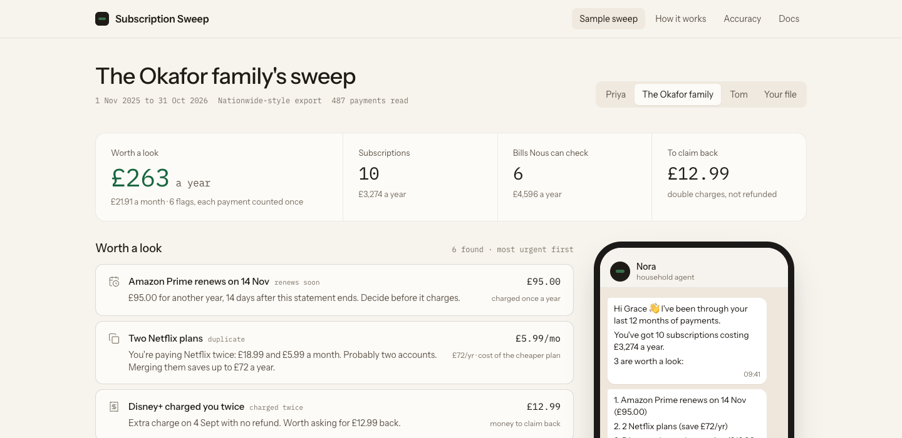
*Before. The switcher's place depends on the title's length.*

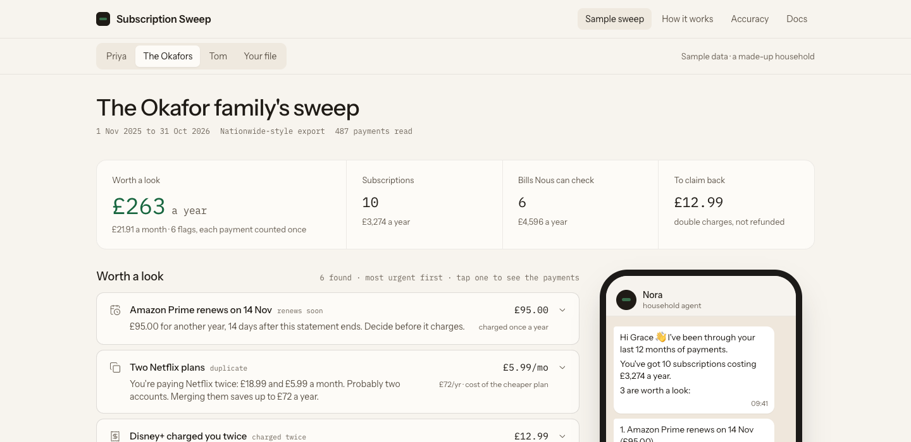
*After. The household bar is pinned under the nav, in the same place on every household and while scrolling.*

What changed:

| | Before | After |
|---|---|---|
| Household switcher | Beside the title, moved with it | Pinned bar under the nav, never moves. A highlight slides to the current household. Arrow keys switch |
| Clicking a household | Jumped to the top | Stays put. If you're far down, it glides back to the new totals |
| Scrollbar | Came and went | Space always reserved |
| Numbers | Snapped | Roll from the last household's figure to the new one |
| Cards, table, lists | Swapped instantly | Rise in one after another |
| Chart | Static | Bars grow, then glide between households. Hover a bar for that month |
| Nora's message | All at once | Bubbles arrive one by one with a typing indicator, each taking its full space from the start, so nothing below moves |
| Flags | Text only | Tap one to see the payments behind it, newest first, with the bank text |
| Phone | Nav wrapped onto two lines, four stat boxes stacked | One-line nav, headline figure with three compact boxes underneath |

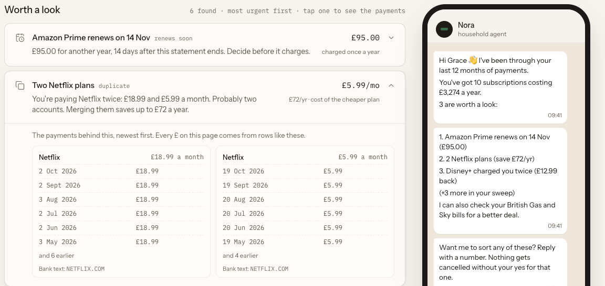
*Tap a flag to see the payments behind it. This answers the top complaint in the Trustpilot reviews: people didn't trust the money maths, so the card shows its working.*

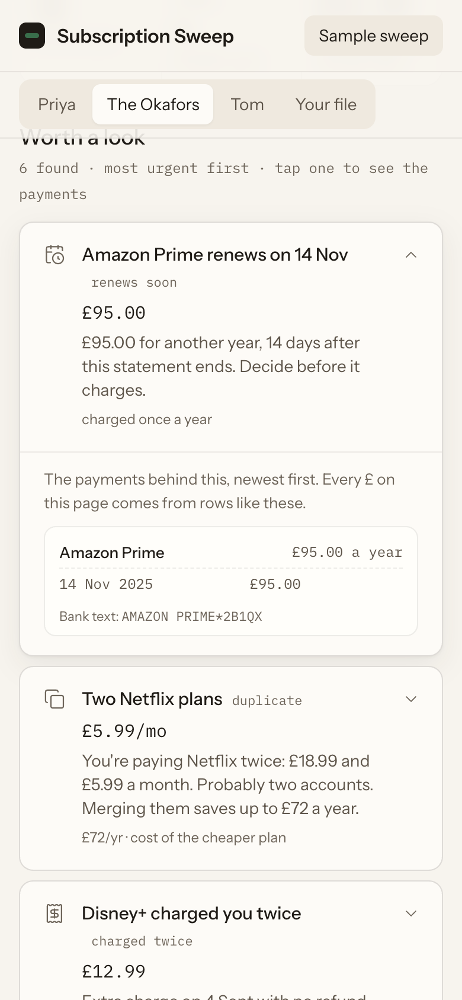
*On a phone the bar stays pinned and scrolls sideways rather than wrapping.*

Two rules I held to. Nothing already on screen jumps: things fade and rise a few pixels into place. And animations only use transforms, which never count as layout movement, so the chart bars slide up inside a fixed frame instead of changing height. Everything switches off for people who set their device to reduce motion.

I measured it rather than eyeballing it. The QA script clicks through every household and checks the switcher's exact position before, during and after each click, and records every layout shift the browser reports. First run: the switcher never moved, but the small grey lines under the numbers shuffled by fractions of a pixel as the numbers rolled, because that font's digits are different widths. Fix: only the big numbers roll (their font has same-width digits).

## 18. Real bank files (4 Nov)

People testing it will drop in their own statement, so I made test files in the awkward layouts UK banks actually export and ran them through the reader exactly as the browser read files then. **It got 1 of 8 right.**

| Layout | What's awkward | First run | After |
|---|---|---|---|
| HSBC-style | No header row | 0 payments read | 39 read, PureGym and Netflix found |
| Nationwide-style | Old Windows text, so the £ sign is a different byte | 0 read, every amount rejected | 18 read |
| Amex credit card | Charges positive, repayment negative | The card repayment listed as a subscription, the 3 real ones missed | Adobe, Audible, Netflix. Repayment ignored |
| Revolut | Declined and reverted payments in the file | 2 false "charged twice" flags | Left out, no false flags |
| NatWest/RBS | Excel apostrophes, "Value" column | Right | Right |
| Santander text file | Not a CSV at all | 0 read | 12 read |
| Semicolons | Not commas | 0 read | 12 read |
| One month only | Too short to repeat | "Nothing looks off" | "This file only covers 26 days", and Nora asks for 3 to 12 months |

Now the reader looks at the file's first bytes before anything else. A PDF or an Excel file gets told how to get the CSV instead of a confusing columns error. It also reads OFX and QIF downloads, and you can drop a current account and a credit card together: if the same payment is in both, it counts once.

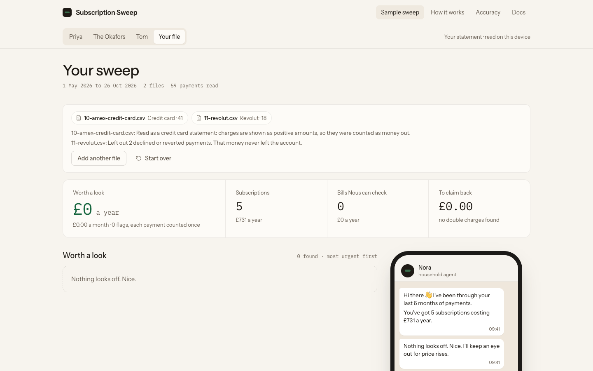
*Two files at once. The notes say how each was read: positive card charges counted as money out, declined Revolut payments left out.*

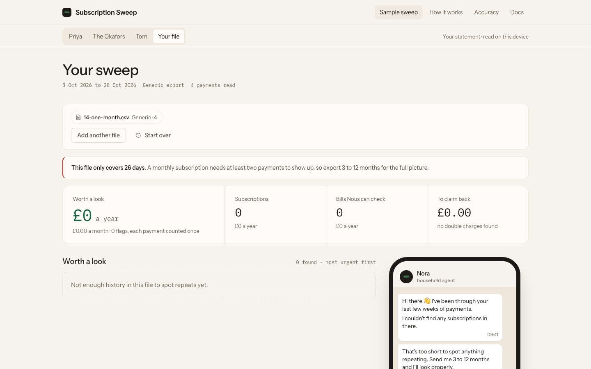
*A one-month file is never called all clear.*

Not blind: I wrote these files and the fixes. That proves the layouts are handled, not that every bank's export matches them exactly. Evidence: `docs/evidence/09-…first-run.md` and `10-…after-fixes.md`.

## 19. Production checks (4 Nov)

- **Speed.** A 400,000-payment file took 19 seconds and froze the page. Two fixes: each bank description is looked up once instead of on every payment, and the price grouping keeps a running total instead of re-adding the group each time. Now 1.5 seconds, and it runs in a background thread, so the page keeps animating while it reads. Same answers: unit tests, the sample households and both blind sets score exactly as before.
- **"Never uploaded" is enforced, not just written.** The site is served with a security policy (`connect-src 'none'`) telling the browser to refuse any request this page tries to send, to any server. It's strict enough that it blocked my own accessibility checker from injecting its script. Fonts are now served from the site itself instead of Google, and there are no analytics.
- **Drop a file anywhere.** Before, a file that missed the drop zone made the browser open it and leave the site.
- **Accessibility.** The light grey text was slightly too faint (4.3:1 against the 4.5:1 standard), and so was the teal "Not now" chip. Both darkened. Skip link, keyboard focus after an upload, and screen readers get final numbers, not rolling ones.
- **Smaller download.** The docs load only when opened: 150 KB to 123 KB compressed.

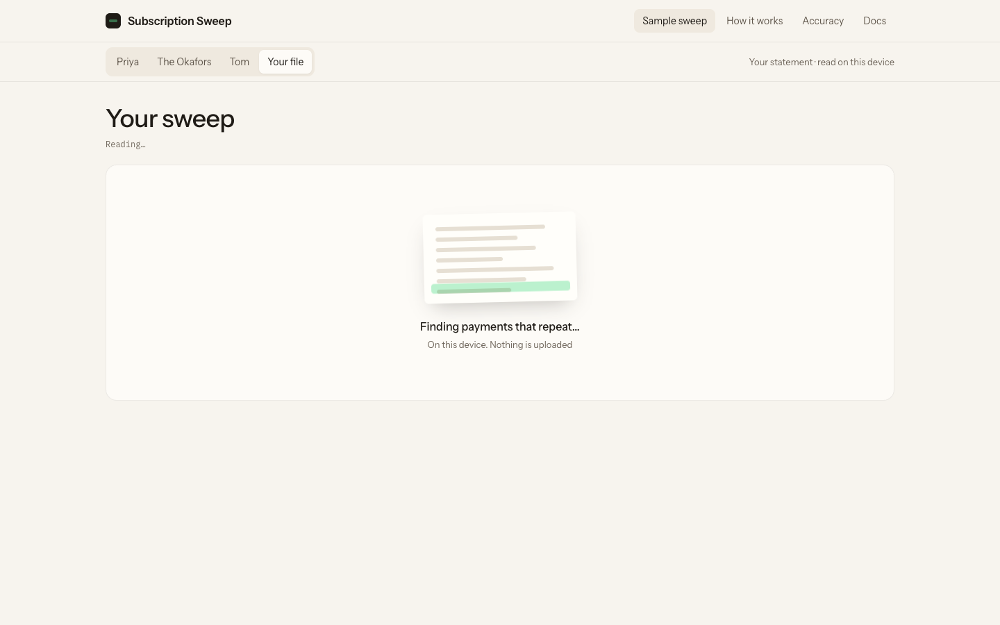
*While it reads: a highlighter running down a statement.*

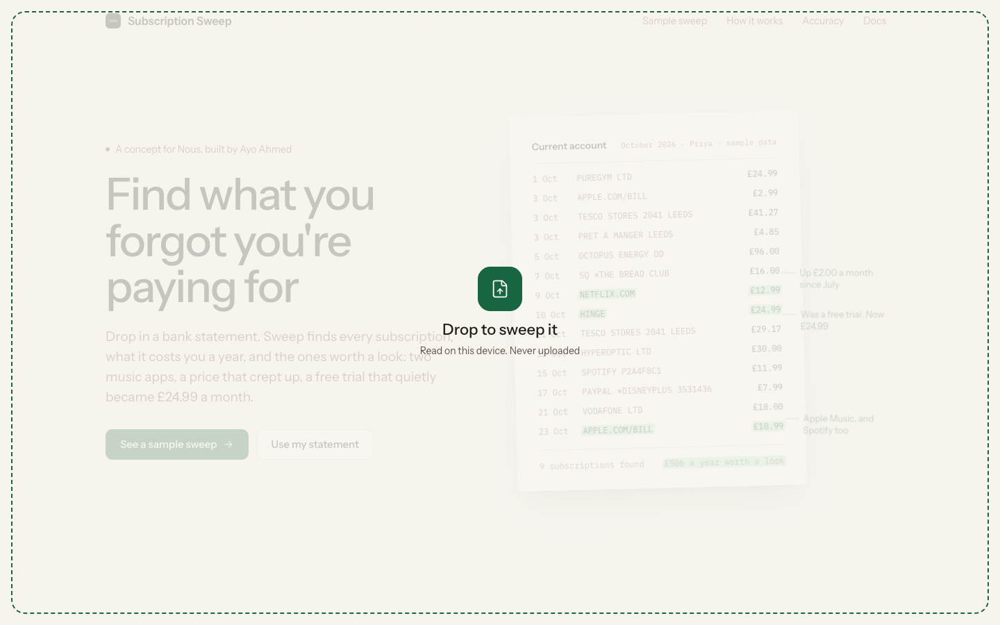
*Drag a statement anywhere on the site.*

How I tested it:

| Test | First run | Now |
|---|---|---|
| Browser QA: stability, interactions, 17 upload cases, phone, reduced motion, accessibility (`scripts/qa.mjs`) | 76/88 | 89/89 |
| Random use: 300 random clicks, scrolls, resizes, uploads, back/forward per run (`scripts/monkey.mjs`) | 2 of 3 runs found problems | 6 runs clean |
| Unit tests | 35 | 54, including every new bank layout |

The random-use test found three bugs no scripted test caught. Shrink the window from laptop to phone size and the page scrolled sideways by up to 242px: the nav's sliding highlight went invisible when its link was hidden on phones, but stayed parked at its laptop position, past the edge of the screen. On a phone, a long file name made the upload report wider than the screen. And after I made the docs load on demand, clicking Docs showed a near-empty page for a moment; they now load quietly once the first page is idle. All three fixed, and the first two now have a permanent check.
