# Subscription Sweep: go-to-market

**Owner:** Ayo Ahmed · **Written:** 5 Nov 2026 · **Status:** plan, not yet run

> How Nous would get people using the sweep, built on the channels Nous already runs. Every number comes from public data and is sourced at the bottom. None of it is Nous's internal data.

## TL;DR

Nous already has a growth machine: creator video ads tested in a week, a referral programme, and free money tools that win search. Subscriptions aren't in any of it. So the plan isn't a new channel. It's subscriptions plugged into the channels that already work, cheapest first:

| Order | Bet | Why this order | What it costs |
|---|---|---|---|
| 1 | Send the sweep to members Nous already has, in WhatsApp | Nearly 250,000 households, no ad spend, and the natural moment to offer Premium | Engineering only |
| 2 | Add a subscriptions line to the sign-up savings estimate | Every new member sees that screen before they give their name | One line, one A/B test |
| 3 | One new hook in the creator ad loop | Nous stops a losing ad after a median of 7 days, so a test costs a week | A week of test budget |
| 4 | "How to cancel X" pages with the sweep built in | About 60,300 UK searches a month, at £0.87–£2.28 a click (energy: £14.85) | Content, then time |

One rule runs through all of it: **the sweep lists Nous Premium too.**

## How I worked out how Nous grows

Before planning anything, I reverse-engineered how Nous gets its members from public data only. I scraped their whole ad history from three ad libraries, read their site's tracking code, and pulled two years of search estimates, their subdomains, Companies House filings, funding news and reviews. Most of it runs through my own research tool, voc, which does a teardown like this in one command, and the paid data cost about $0.35. First pass on 28 Oct, wider pass on 5 Nov.

| Source | What I pulled |
|---|---|
| Meta Ad Library | 1,000 ads (161 live): run lengths, creators, landing pages, top videos transcribed |
| Google Ads Transparency | 40 ads |
| TikTok ad library | 37 ads |
| Their site's code | Google Tag Manager and Segment settings, which every visitor downloads |
| Search estimates | 24 months of traffic, 76 keywords |
| Certificate logs | 39 subdomain names (none visited) |
| Companies House and news | Filings, directors, funding |
| Trustpilot | The newest 106 reviews, plus 477 analysed on 3 Nov |

### 1. Every ad sells bills and energy

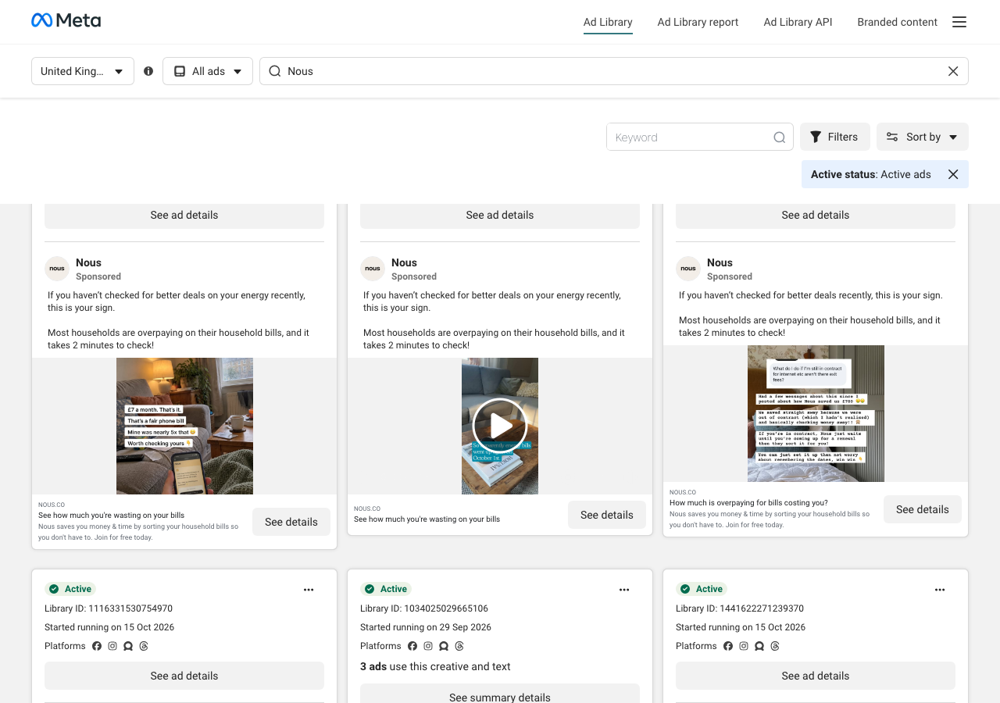
*Nous's live ads in Meta's Ad Library (UK, captured 28 Oct). Every one opens with bills or energy.*

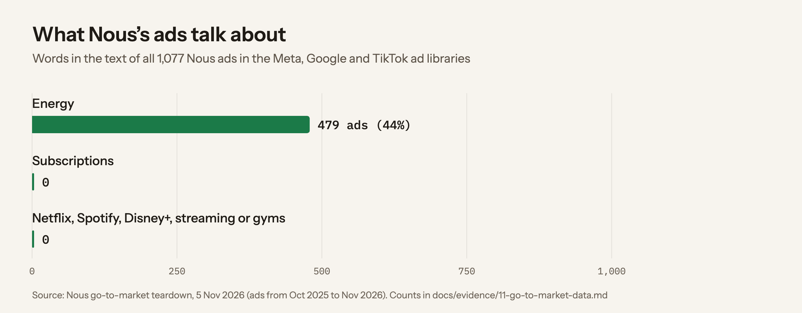
*0 of 1,077 ads mention subscriptions. My first pass on 28 Oct found the same in 1,268 opening lines: 41% lead with energy, none with subscriptions.*

### 2. They test fast, and kill half their ads within a week

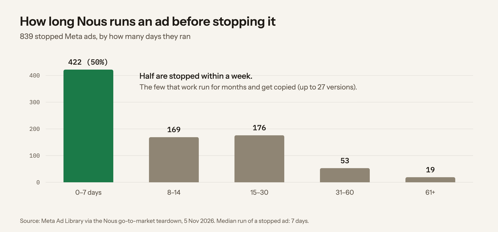

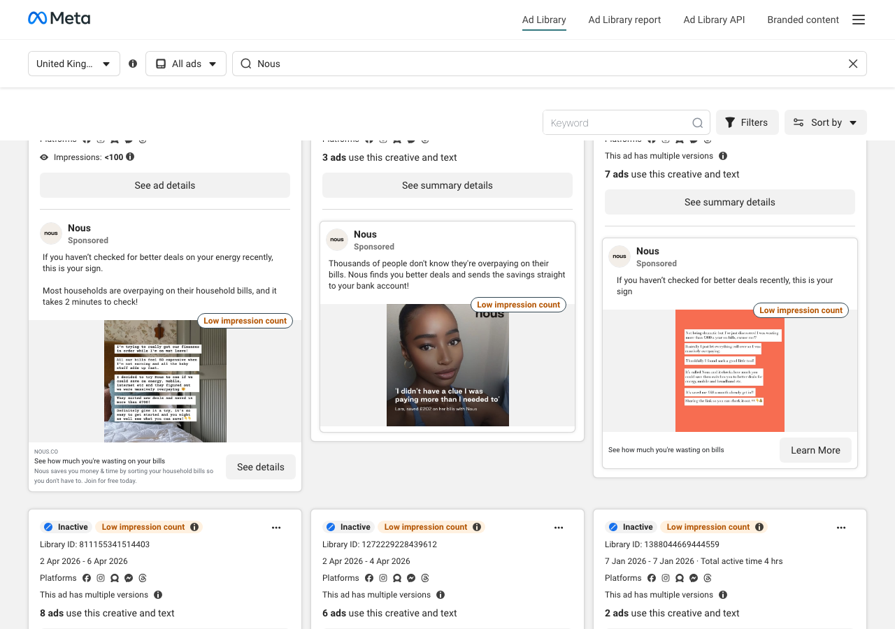
*Stopped ads in the library (captured 28 Oct). One ran 2 to 6 April; "8 ads use this creative and text" is one idea tested in eight versions.*

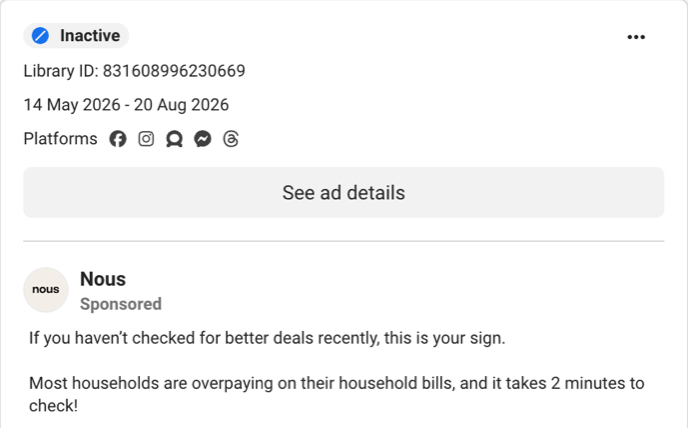
*The winner: 14 May to 20 Aug 2026, 98 days and 12 versions (Library ID 831608996230669, captured 5 Nov). The video opens: "I'm not being dramatic, but I've just found out I've been overpaying on my bills by like over £700 a year." Their 102 creator ads come from 32 creators, many of them small paid video-makers rather than big influencers.*

### 3. They buy ads where nobody can see

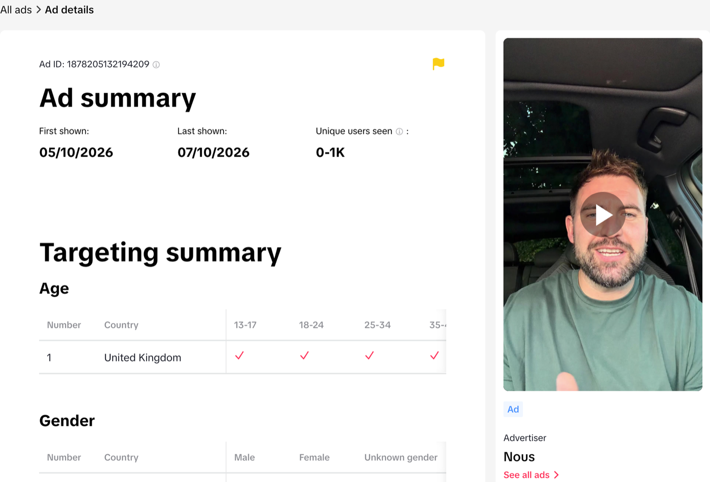
*One of their 37 TikTok ads: first shown 5 Oct, last shown 7 Oct, UK only. That confirms the TikTok tracking spotted in their site code is real ad spend. (TikTok's ad library only covers the UK and Europe.)*

Their site code reports conversions to Meta, Google, TikTok, X, Reddit and Bing. That usually means they buy ads on all six, including the three that have no public ad library.

### 4. Search brings in little beyond their own name

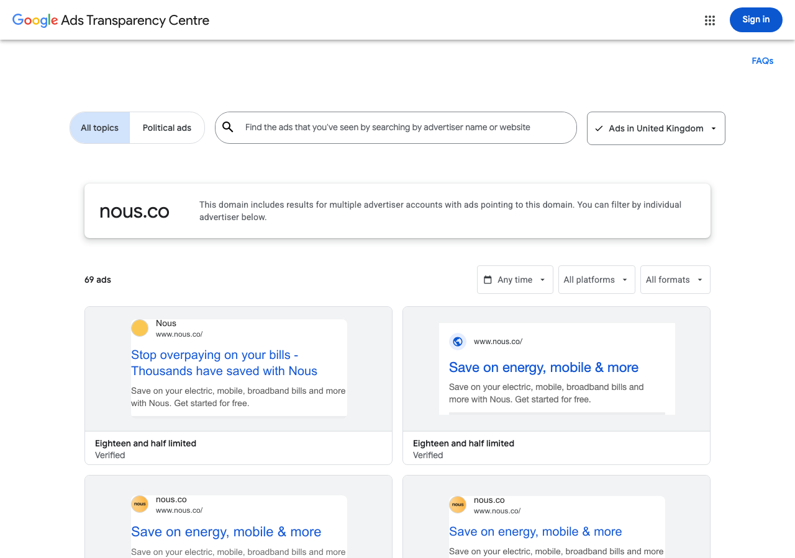
*Google's ad transparency page for nous.co (captured 28 Oct): search ads on bills, "Stop overpaying on your bills". The oldest has run 383 days.*

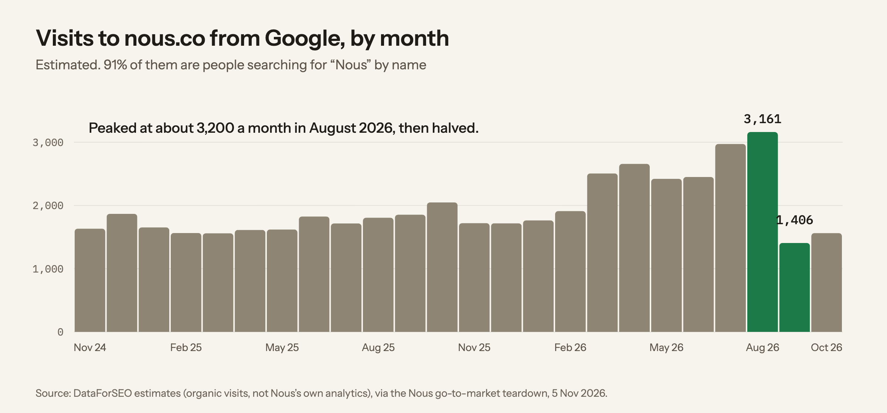
*Google search traffic peaked at about 3,200 visits a month in August 2026, then halved. 91% of searches that find them are people typing "Nous". Apart from their own name, they mostly get found through their tax-calculator pages (number 1 for "how much would 2p on income tax cost me").*

### 5. Money and momentum

- **Funding:** the £12.7m ($17m) Series A on 26 Oct 2026, with the investors named in the news: led by Heartcore Capital, with Mosaic Ventures and Monzo founder Tom Blomfield.
- **Members:** nearly 250,000 households, and the last 100,000 joined in 100 days (founder's post, 26 Oct).
- **A growth programme built this year:** share, creators, affiliates-hub and influencers subdomains, all new in 2026, plus 100 /invite/ pages. They're hiring a Growth Lead.

## What it means for the sweep

| Channel | So what |
|---|---|
| Meta ads | A new angle gets tested in a week, and "see how much you're wasting" is already the winning frame. Subscriptions fit it |
| Creators | Briefing three creators on a subscriptions script is a normal week for them |
| TikTok | The same hook can run on a second platform |
| Search | Nous wins search with tools that answer one question. The sweep is that kind of tool |
| Referrals | A shareable result has somewhere to go: share.nous.co |
| Members | The biggest audience for a new feature is already signed up |

## Where the demand is

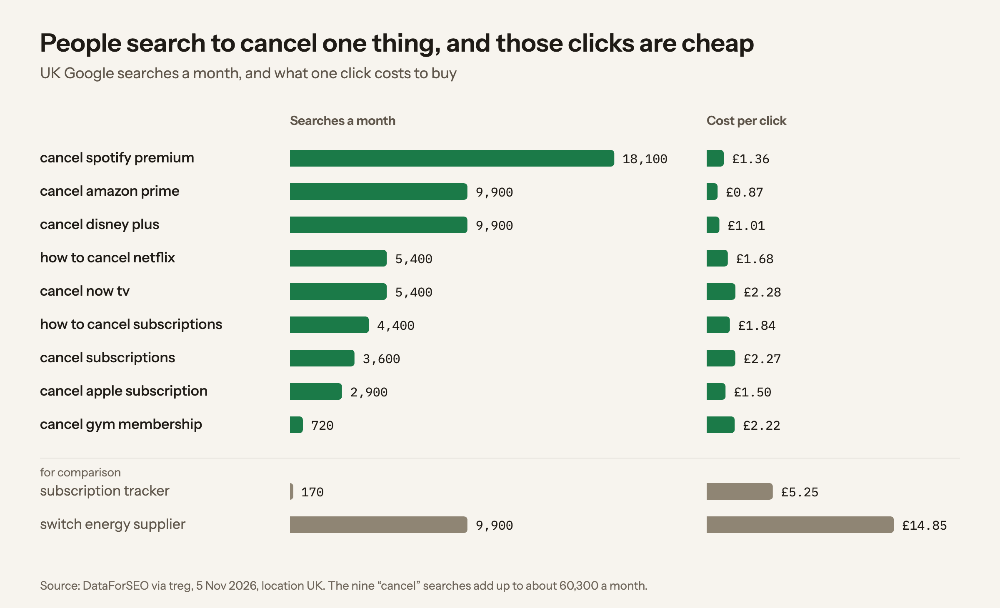
*People don't search for a "subscription tracker" (170 a month). They search for how to cancel one specific thing: about 60,300 a month, at £0.87–£2.28 a click, against £14.85 for "switch energy supplier".*

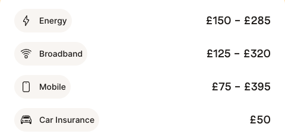
*And at sign-up, the savings estimate lists energy, broadband, mobile and car insurance. There's no subscriptions line (build log, section 20).*

**The opening: meet people while they're cancelling one subscription, and show them the others.**

## Who it's for, in order

1. **Members who joined for energy.** The sweep is value in month one that isn't a switch, and the clearest reason to upgrade to Premium, which already promises subscription tracking.
2. **People cancelling one subscription.** High intent, cheap clicks, and most have never heard of Nous.
3. **People who would sign up for bills anyway.** The sweep adds a second number to the estimate that brought them in.

## The path a member takes

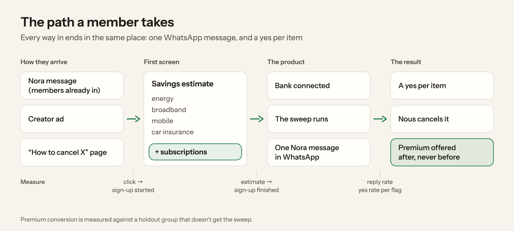
*Every way in ends in the same place: one WhatsApp message, a yes per item, and Premium offered only after.*

## Four experiments

| # | What we'd do | Why it should work | Measure | Stop if |
|---|---|---|---|---|
| 1 | Send members their sweep in WhatsApp: 5% of eligible members first | WhatsApp is praised by name in reviews, and 54% of 4–5★ reviews praise "done for me" | Reply and yes rate against Nora's other messages; Premium against a holdout group | A flag type is called wrong more than 2% of the time |
| 2 | A "Subscriptions: checked once your bank is connected" line on the sign-up estimate, with **no £ figure** | Every new member sees this screen. A guessed number would repeat the top complaint (43% of low reviews are about money judgement) | Estimate to name-step conversion, A/B tested in Statsig, which Nous already runs | No lift after two weeks |
| 3 | A subscriptions hook: three creators, each showing **their own real sweep**, and one /subscriptions page | Nous tests a hook in about 7 days, and its creators already make the "I was overpaying by £700" format | Cost per sign-up against the energy ads; share who connect a bank | More than 1.5 times the energy cost after 7 days |
| 4 | "How to cancel X" pages with the sweep built in: Spotify, Prime, Disney+, Netflix, NOW | 60,300 searches a month, and Nous already ranks number 1 with one-question tools | Rankings, visits, sweeps per visit, sign-ups | Not in the top 10 after three months (paid clicks answer in a week) |

The creator script, in 30 seconds to camera: what surprised them ("two music apps", "a trial I forgot") → the WhatsApp message on screen → "I said yes to one, and it was cancelled" → "it checks your energy too".

## The rule that runs through all of it

Of the 13 reviews at 3★ or below from 27 Oct to 4 Nov, **5 are about Nous acting without consent or adding Premium without asking**: "Put me through on a premium subscription which I didn't ask for and now am having problems cancelling" (4 Nov). A subscriptions feature from a company accused of unwanted subscriptions is either a trust win or a headline. So:

- **The sweep lists Nous Premium too**, with the same yes per item and the same easy cancel. Nothing earns trust faster.
- **A yes per item, nothing on silence.** No "reply YES to all".
- **No upsell in the sweep message.** Premium is offered after a member has acted, never as a condition.
- **A "that's wrong" button on every flag**, reviewed weekly.

## First 30 days

| Week | What happens |
|---|---|
| 1 | Run the rules on real, consented data and build the eval from 50 hand-labelled households (PRD, "first 30 days"). Put the estimate line live as an A/B test |
| 2 | Send the sweep to 5% of eligible members. Brief three creators |
| 3 | Run the creator ads for 7 days. Publish the first two cancel pages and buy clicks on them |
| 4 | Read the results, keep or drop each experiment, and scale the winning creator |

**North star:** £ a year that members chose to stop paying, counting only what they said yes to, not everything we flagged. **Guardrails:** "that's wrong" under 2% per flag, opt-outs, and complaints that mention consent.

## What I don't know yet

- How many members have connected bank data, and how much history they have.
- Nous's real cost per sign-up by hook. The ad library shows how long an ad ran, not what it cost.
- Whether Premium's subscription tracking already reaches members.
- Search volumes are estimates, and "cancel Spotify" competes with Spotify's own help page.

## Sources

- Nous go-to-market teardown, 5 Nov 2026: Meta Ad Library (1,000 ads), Google Ads Transparency (40), TikTok ad library (37), DataForSEO search estimates, PredictLeads funding news, Companies House, Trustpilot (106 reviews from 27 Oct to 4 Nov), public DNS and site code. The counts are in `docs/evidence/11-go-to-market-data.md`.
- First pass, 28 Oct 2026: the opening lines of 1,268 Nous ads from Meta's Ad Library (page 104181918671731), the creators behind them, and the screenshots marked 28 Oct.
- UK monthly Google searches and cost per click: DataForSEO, 5 Nov 2026, location GB.
- Screenshots marked 5 Nov: Meta Ad Library (ID 831608996230669) and TikTok's Commercial Content Library (ad 1878205132194209), captured logged out.
- Charts: drawn from those numbers by `scripts/gtm-charts.mjs`.
- Sign-up screens: build log, section 20. Review themes: `research/reviews/findings.md` (477 Trustpilot reviews, 3 Nov).
- Founder's post: https://x.com/gregmarsh/status/2114682639818862603. Funding and investors: https://tech.eu/2026/10/26/nous-lands-17m-to-bring-ai-powered-household-management-to-more-homes and https://x.com/thestartpod/status/2114771543486079030 (both 26 Oct 2026).
